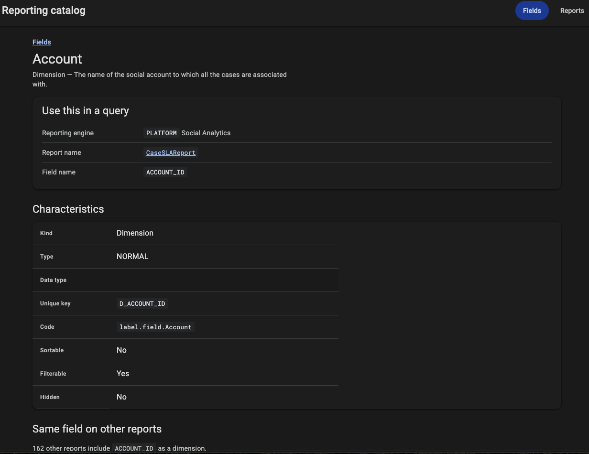
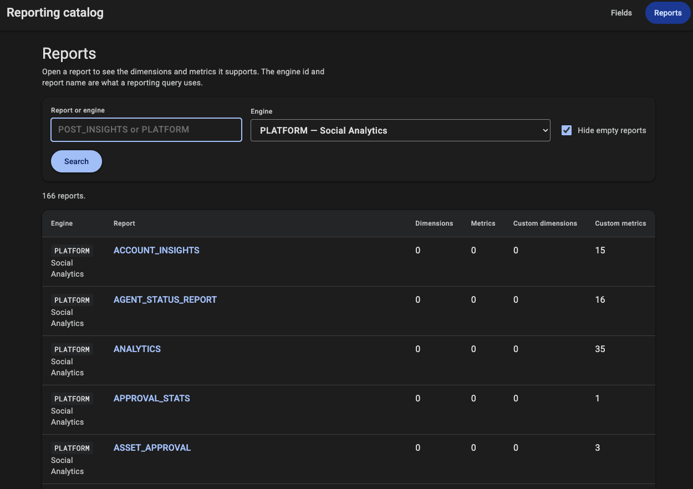
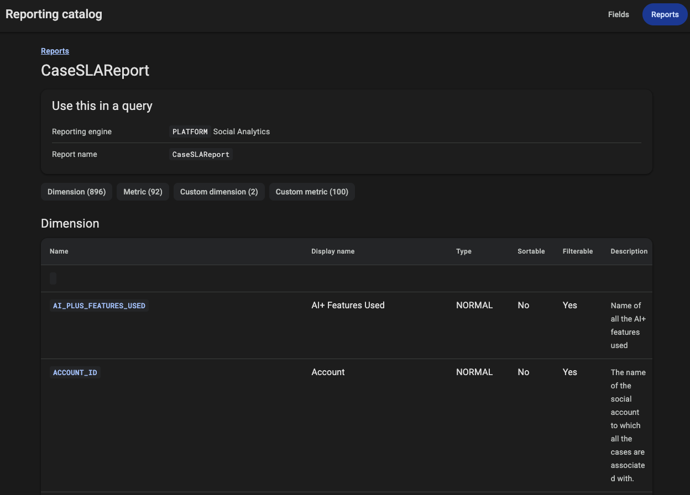

# Sprinklr reporting catalog

A local catalog of Sprinklr reporting engines, reports, dimensions, and metrics. It answers which reporting engine and report name to use when you need a specific field, and what that field looks like: display name, type, description, unique key, code, and whether it can be sorted or filtered.

Three pieces:

| File | Role |
| --- | --- |
| `sprinklr_client.py` | Generated Sprinklr API client (`SprinklrClient`) |
| `reporting_db.py` | Loads one JSON file per engine and report into SQLite, and can query it from the command line |
| `reporting_explorer.py` | Flask app for browsing the database by field or by report |

`templates/` and `static/` belong to the Flask app.

Python 3.10 or newer. SQLite comes with Python and needs FTS5, which the standard library build includes. No database server to install.

## Setup

```bash
python3 -m venv .venv
source .venv/bin/activate
pip install -r requirements.txt
```

`requests` is for the API client. `flask` is for the explorer. The database builder uses only the standard library.

## Catalog files

Put one JSON file per reporting engine and report in `reporting_catalog/`, next to these scripts. `reporting_db.py` reads that directory and loads it into SQLite.

Each file looks like this:

```json
{
  "reporting_engineId": "PLATFORM",
  "report_name": "ANALYTICS",
  "dimensions": [],
  "metrics": [],
  "custom_dimensions": [],
  "custom_metrics": []
}
```

`reporting_engineId` and `report_name` are the values a reporting query uses. They are stored on every row loaded from that file.

An optional `reporting_catalog/index.json` supplies the engine display label and which API version produced the file. The loader skips `index.json` and `_errors.json`.

Objects with `hiddenAndDeprecated` set to true are left out of the database.

These files are partner-specific and are listed in `.gitignore`, along with the SQLite file built from them.

## Build the database

```bash
python reporting_db.py build
```

That writes `reporting_catalog/reporting_catalog.sqlite`, replacing any database already at that path. Flags:

```bash
python reporting_db.py build --catalog reporting_catalog --database reporting_catalog/reporting_catalog.sqlite
```

Import rules:

- One `description` column. The object's `description` is used when it has text. Otherwise the loader uses `langVsTranslatedFieldValues.en.description`.
- `uniqueKey` and `code` become `unique_key` and `code`.
- `channelTypes`, `measurementGroups`, `groupNames`, and `dashboardGroups` become rows in `field_values`.
- Each `filters` entry becomes a `field_filters` row. Each `requiredProjections` entry becomes a `field_projections` row.
- The original object is kept in `fields.payload`.

### Query from the command line

At least one of `--name`, `--search`, `--kind`, `--engine`, or `--report` is required.

```bash
python reporting_db.py query --name date --kind dimension --engine PLATFORM
```

`--name` matches `name`, `field_name`, and `display_name`. `--search` matches the description. `--engine` accepts an engine id or its display label. `--hidden true` keeps only hidden fields. `--hidden false` drops them. `--sort` accepts `display_name`, `name`, `engine`, `report`, `kind`, or `type`. `--limit` defaults to 100. Use `--limit 0` to print every match.

## Explore in the browser

```bash
python reporting_explorer.py
```

Open [http://127.0.0.1:5050](http://127.0.0.1:5050).

**Fields** searches by field name, field id, or display name. Each row is a report that can query that field, with the engine id and report name. A field page shows its characteristics, related lists, filters, and the measurements it is built from, plus other reports that include the same field.



**Reports** lists engines and report names. Empty reports (no dimensions, metrics, custom dimensions, or custom metrics) are hidden until you clear **Hide empty reports**.



A report page lists its fields by kind.



The app reads the database in read-only mode. Rebuild with `reporting_db.py build` after the catalog JSON changes, then restart the app.

## Tables

`reporting_engine_id` and `report_name` are columns on every table, so a field can be tied to the query that uses it without a join.

- `reports` — one row per engine and report, including the display label from `index.json`.
- `fields` — one row per dimension, metric, custom dimension, or custom metric. Kind is `dimension`, `metric`, `custom_dimension`, or `custom_metric`.
- `field_values` — one row per channel, measurement group, group name, or dashboard group. `list_name` is `channel_type`, `measurement_group`, `group_name`, or `dashboard_group`.
- `field_filters` — one row per filter, with `filter_type`, `field_name`, and `values_json`.
- `field_projections` — one row per required projection, with `measurement` and `aggregate_function`.

Name search uses an FTS5 trigram index on `name`, `field_name`, and `display_name`. Description search uses a second FTS5 index. Matches are then checked so the text actually occurs in the field.

## API client

`sprinklr_client.py` is the generated client. Calls return true or false. The decoded body is `client.result`. A failure is `client.error` and is not raised.

```python
from sprinklr_client import SprinklrClient

client = SprinklrClient(
    host="https://api3.sprinklr.com",
    api_key="...",
    environment="prod",
    access_token="...",
)
if client.v3.user.fetch_current_user():
    print(client.result)
else:
    print(client.error)
```

Keep the API key and access token out of git.
